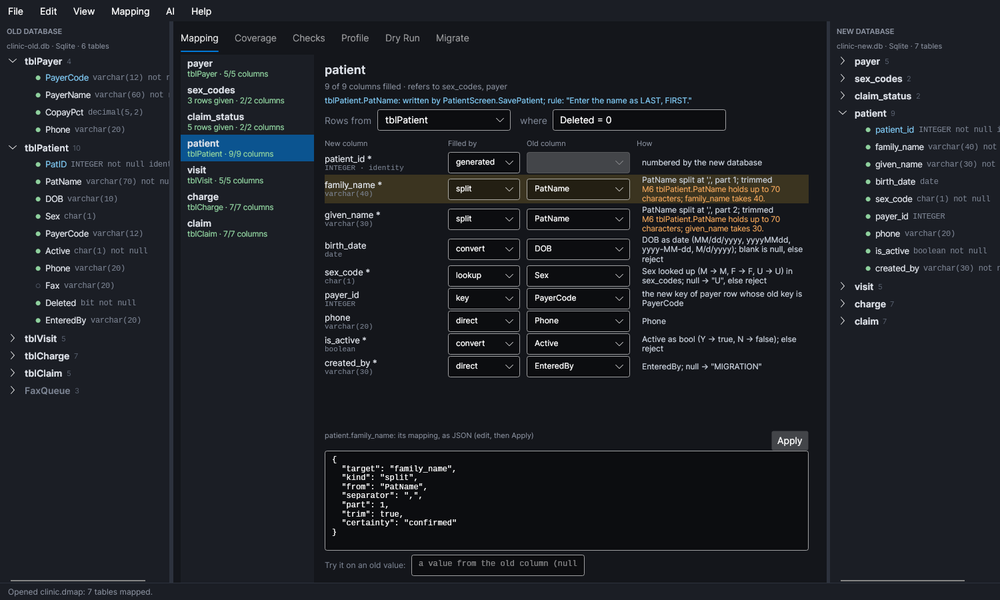
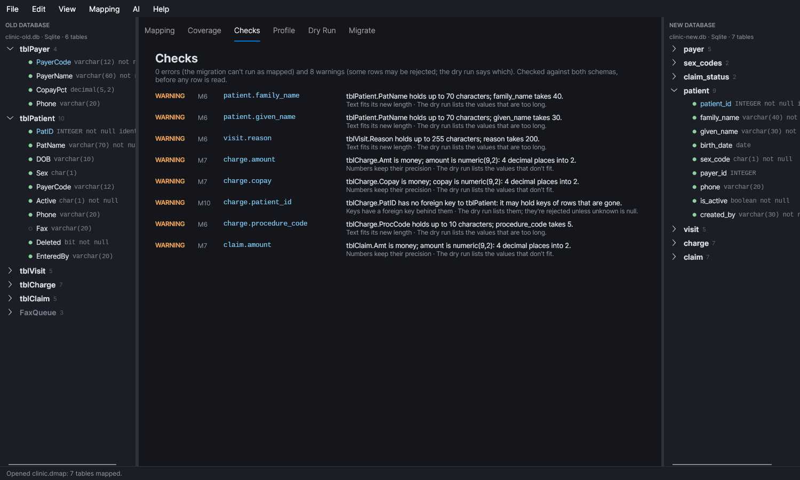
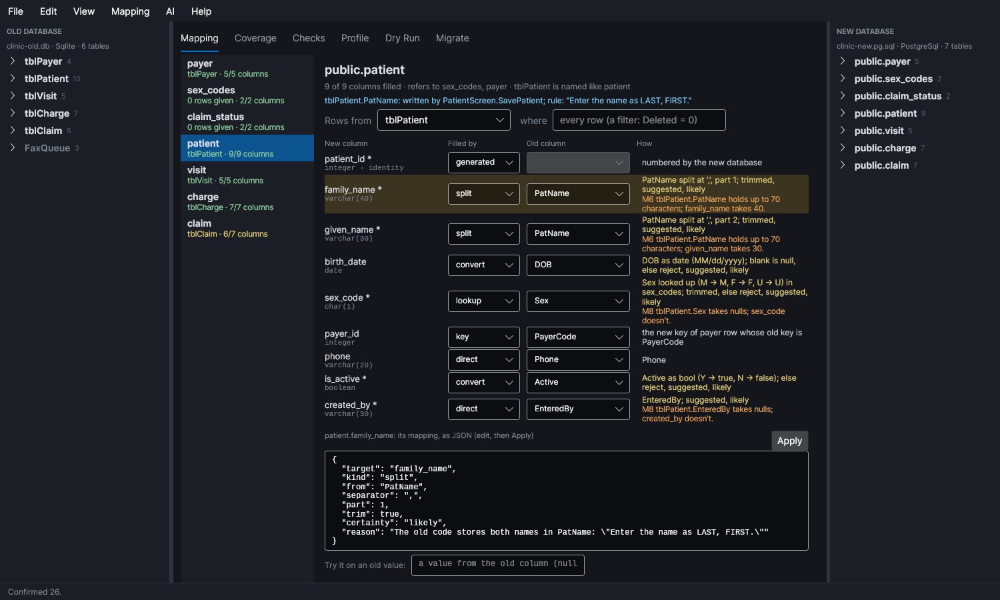
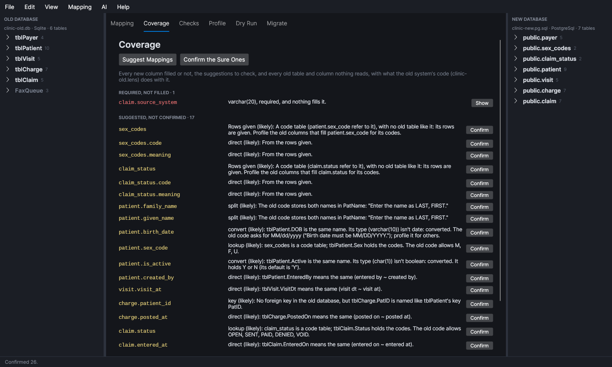
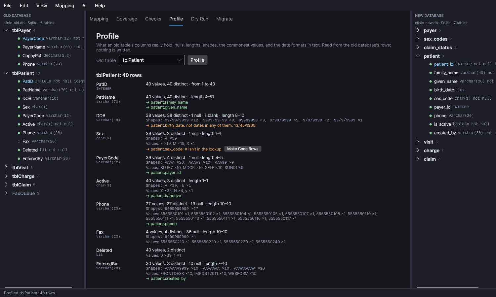
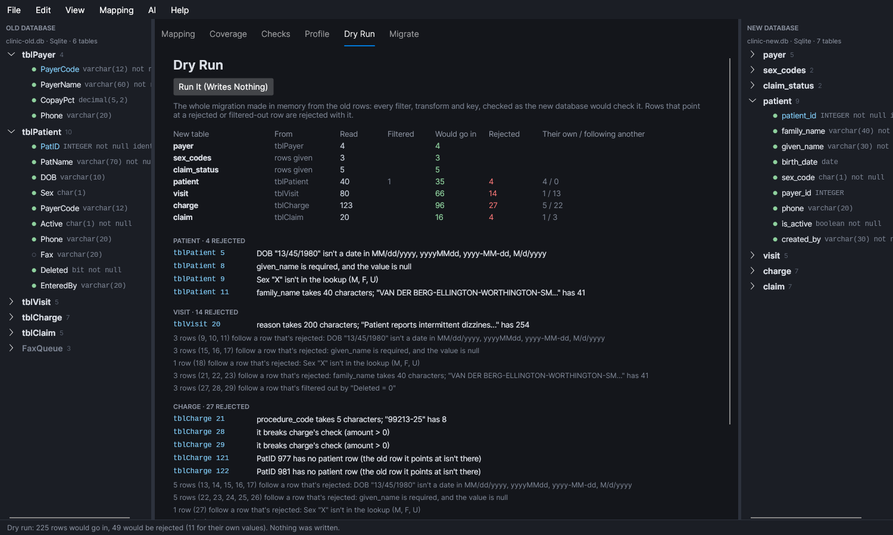
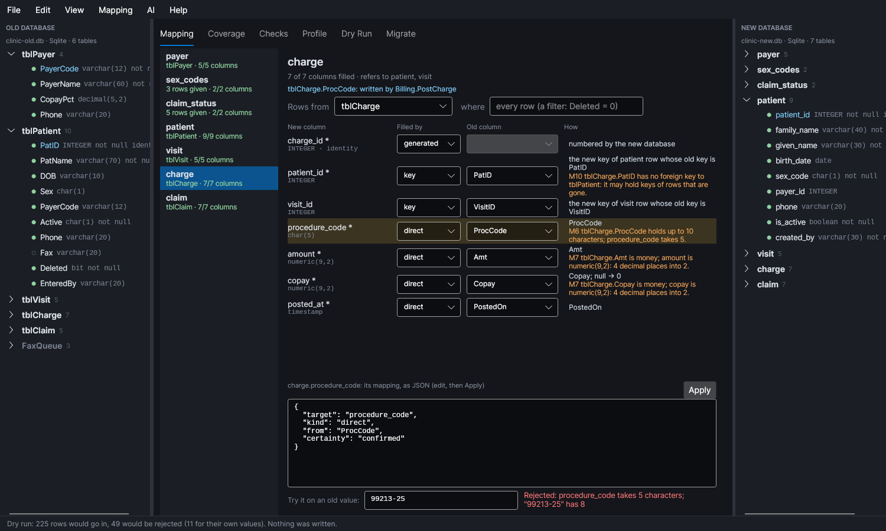
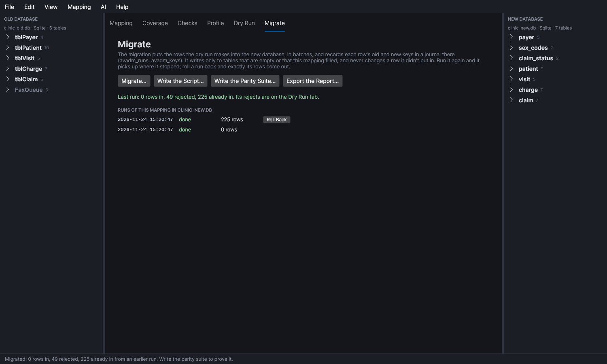
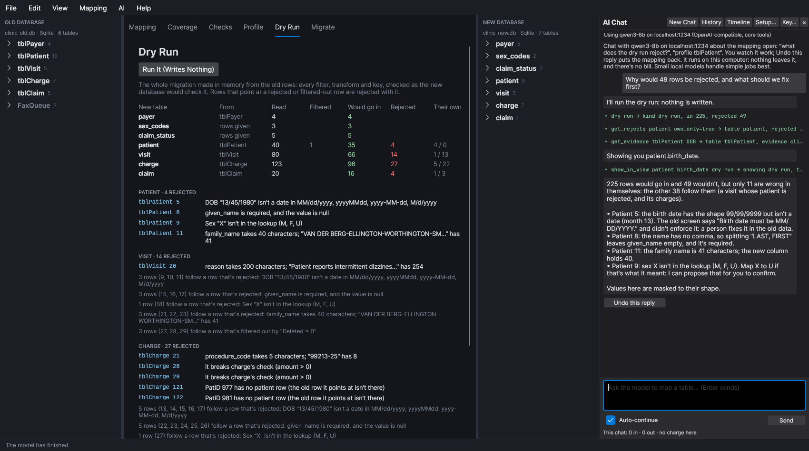
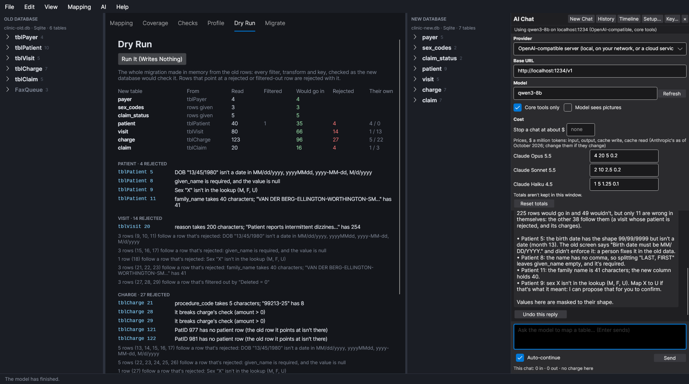

# AVA Data Mapper

Move a legacy system's data into its rebuild, and prove it arrived. AVA Data Mapper reads the old database's schema and
the new one's (**SQL Server, PostgreSQL or SQLite**, live or from DDL scripts) and keeps a **mapping** of how every new
table and column is filled from the old: copied, converted, looked up, split, joined, computed, or through the new keys.
It checks the mapping against both schemas before a row is read, suggests the gaps from names, types, foreign keys and
**the old system's own code** (an [AVALegacyLens](https://github.com/Harlock123/AVALegacyLens) scan), and profiles what
the old columns really hold.

Then it moves the data. A **dry run** makes the whole migration in memory and writes nothing: every row that would go in,
and every row that wouldn't, by its old key, with every reason. The **migration** runs the same engine into the new
database, only into tables that are empty or that this mapping filled, and records every row so a rerun picks up where
it stopped and a run can be **rolled back**. It writes the migration as a **SQL script** too, the **sign-off report**,
and the **proof**: an [AVAParityCheck](https://github.com/Harlock123/AVAParityCheck) suite that compares what the
mapping says should be there with what is.

It has an **AI Chat** (F12) and an **MCP server**, so Claude or a model on your own computer can suggest and explain a
mapping, find what's dropped, and explain every reject. **Agents see values masked** unless you say otherwise, what
they map is a proposal you confirm, and they migrate only when you say yes. See [AI: the chat and agents](#ai-the-chat-and-agents).



## Download

Builds for Windows, macOS and Linux (Intel/AMD and ARM) are on the
[releases page](https://github.com/Harlock123/AVADataMapper/releases). Unzip or untar and run `AVADataMapper`
(`AVADataMapper.exe` on Windows); nothing else needs installing.

## The mapping

**File › Open Schema** reads each side from a SQLite file or a DDL script (T-SQL through Microsoft's own parser;
PostgreSQL and SQLite), and **File › Connect** reads a live server's catalog (never a row). Connection strings are kept
in your settings, readable by you only, and never in the mapping: a `.dmap` names its sides and is plain, stable JSON
that diffs well in source control.

For each new table, the old table its rows come from and which of them (`Deleted = 0`), or, for a code table, its rows.
For each new column:

| Kind | Fills it with |
|---|---|
| `direct` | The old column as it is |
| `convert` | To a date (with the formats text holds), number, integer, boolean (`Y → true`) or text |
| `lookup` | Old codes through a map, into a code table (`X → U`) |
| `key` | The new key of the row an old key pointed at, through the key map of a table loaded before |
| `split`, `merge` | A part of a column (`LAST, FIRST`), or columns joined |
| `constant`, `default` | A value, or the new column's default |
| `expression` | The mapping's own small language (`upper(trim(Code))`, `iif(Amt < 0, 0, Amt)`), never SQL |
| `generated` | Numbered by the new database |

with options for trimming, case, blanks as nulls, what a null becomes, and what a value that doesn't convert does
(reject the row, null, or default). Every change is one undo step, and the **Try** box runs a column's mapping on any
old value you type.

**The checks** (M1 to M15) read the mapping against both schemas before any row: errors that stop a migration (an old
column that isn't there, a type that doesn't fit, a key into a table nothing fills, a lookup giving codes its code table
hasn't got) and warnings of rows that will be rejected (text cut short, precision lost, nulls into required columns,
keys with no foreign key behind them).



**Suggest Mappings** fills what isn't mapped (never changing what is): tables by name and columns, columns by name
(prefixes dropped, `DOB` read as birth date, `is_active` as `Active`) and type, keys through foreign keys, lookups into
code tables, and a name column split when the old code says `"Enter the name as LAST, FIRST."`. Each is marked
**sure**, **likely** or **guessed** with its reason, and stays a suggestion until you confirm it.



**Coverage** says what's filled and what isn't: required columns nothing fills, suggestions not confirmed, and every old
table and column nothing reads, with what the old code does with it, or that was dropped, why, and who decided.



## Profiles and the dry run

**Profile** reads an old table's rows: nulls, blanks, lengths, value shapes (`99/99/9999`), the date formats text
really holds and the values none of them reads, ranges and the commonest values. **Use These Formats** and **Make Code
Rows** take what it found into the mapping.



**The dry run** makes every new row in load order through the filter, transforms and key map, and checks it as the new
database would: types and lengths, required columns, foreign keys and codes, unique keys, and its CHECK constraints.
It lists every row it would reject by old key with every reason, and the rows rejected only because a row they point at
was, grouped under that first cause, so you fix the cause, not the 38 rows behind it.





## The migration and the proof

**Migrate** runs the same engine as the dry run into the new database, in batches of 500 rows (a transaction each), with a journal it keeps there
(`avadm_runs`, `avadm_keys`: each row's old and new keys). It writes only into tables that are empty or that this
mapping filled; a rerun skips the rows already in; **Roll Back** takes out exactly one run's rows and nothing else.



- **Write the Script** writes the migration as INSERTs for an empty database (SQL Server, PostgreSQL or SQLite), with
  the new keys written out and the rejects listed, for a DBA to read and run.
- **Write the Parity Suite** writes an AVAParityCheck suite: for each new table, the rows the mapping makes (a CSV)
  against a query of what's in the new table, matched on old keys through the journal and with parents compared by
  their old keys. AVAParityCheck passes it after a migration, and fails it when a row in the new table differs from what the mapping
  says.
- **Export the Report** writes the sign-off report, `.html` or `.xlsx`: counts that add up (read = filtered + in +
  rejected), every reject by old key, every column's mapping in words, the decisions and who made them, and the checks.

## AI: the chat and agents

**AI › AI Chat** (F12) opens a chat on the right. It works with Claude (an Anthropic API key) or a model on your own
computer or network (Ollama, LM Studio, or any OpenAI-compatible server; or a local server that speaks Anthropic's
Messages API), with every tool, or a core set for small models. Undo this reply puts the mapping back.



**Agents see values masked.** In profiles, rejects and reports, the old database's values reach an agent as their shape
(`H******`, `99/99/9999`); codes stay readable (columns of few values used again and again), dates are shown as their
year, numeric keys stay. Schemas, the mapping, the checks and the old code's evidence are not values and are shown in
full. **AI › Let AI Agents See Values** turns masking off; use it only with a model your organisation may send that
data to. Starting with `--mask` keeps it on whatever the setting says. Every answer says `values_masked`.

**Agents propose; you decide.** What an agent maps is marked likely ("Proposed by an AI agent") until you confirm it,
and each change is one undo step. `confirm` asks you in the window. `migrate` and `roll_back` run only in the open
window, when you say yes. The script and the parity suite hold the data, so agents write them only when values are
allowed. Agents only write new files in the working folder.

Outside agents (Claude Code, Claude Desktop, any MCP client) connect in three ways:

```bash
# Attached to the open window (AI › Allow AI Agents must be on): the agent works on the mapping open there.
claude mcp add avadatamapper -- /path/to/AVADataMapper --mcp --attach

# Headless, on a folder of mappings, SQLite databases, DDL scripts and scans.
claude mcp add avadatamapper -- /path/to/AVADataMapper --mcp --root /path/to/project

# Over the network, with a token (AI › Connect an Agent in the window, or headless):
AVADataMapper --mcp --http 8778 --root /path/to/project [--token TOKEN] [--cert CERT --key KEY]
```



| Tool | What it does |
|---|---|
| `list_files` | Mappings, SQLite databases, DDL scripts, scans, suites and reports in the working folder |
| `open_map`, `new_map`, `open_schema`, `open_evidence`, `save_map_as` | Open a mapping; start one from two schemas; use a scan of the old code; save a copy |
| `get_overview`, `list_tables`, `describe_table` | The mapping at a glance; each side's tables in load order; a table's columns, keys, checks and the old code's use of each |
| `get_table_map` | How a new table is filled, column by column, in words and JSON, with certainty and the checks |
| `set_table_source`, `set_column`, `unmap_column`, `set_code_rows` | Propose a table's source and filter, a column's mapping, a code table's rows |
| `suggest`, `confirm`, `drop` | Fill the gaps; confirm (the person is asked); record that an old column isn't migrated and why |
| `undo`, `redo` | The one history the person and agents share |
| `check_expression`, `try_value` | Check a filter or expression; run a column's mapping on a value |
| `get_checks`, `get_coverage`, `get_evidence` | The M rules' findings; what's filled and what isn't; what the old code does with a table or column |
| `profile`, `use_formats`, `use_codes` | What an old table holds (masked); take its date formats and codes into the mapping |
| `dry_run`, `get_rejects` | The whole migration in memory; one table's rejects by old key and reason |
| `export_report`, `write_script`, `write_parity_suite` | The sign-off report; the script and the proof (values allowed only) |
| `migrate`, `list_runs`, `roll_back` | Run, list and roll back migrations (in the open window, after the person's yes) |
| `get_view`, `show_in_view`, `render_view` | What the window shows; select a table, column or tab there; a picture of a table's mapping |
| `batch`, `get_recording`, `save_steps`, `run_steps` | Several calls at once; keep a session's calls and run them again |
| `checkpoint`, `diff`, `render_checkpoint`, `restore_checkpoint` | Remember the mapping and view, see what changed, go back (one undo step) |

Recipes (MCP prompts): map a table end to end, suggest a mapping and review it, explain the dry run's rejects, turn
rejects into mapping rules, find what isn't migrated, try a change and go back, check before migrating, and the
sign-off report. Each is run call by call in the tests.

## Command line

```bash
AVADataMapper [map.dmap] [--real | --mask]       # open a mapping; what agents see
AVADataMapper --mcp [--attach] [--root FOLDER] [--real | --mask] [--http [ADDRESS:]PORT …]
```

## Samples

`samples/` has an invented legacy clinic system, made by `make_samples.py`: `old/` its SQL Server database (DDL, rows,
and a SQLite copy), with `old/code/`, the legacy VB.NET that used it, and `old/clinic-old.lens`, AVALegacyLens's scan of
that code; `new/` the rebuild's PostgreSQL schema (and a SQLite copy); and `clinic.dmap`, the mapping between them.
Problems are planted in the old rows: a birth date of 13/45/1980, a name with no comma, a code nobody defined, a
reason too long for its new column, charges for patients that are gone, a status the new system hasn't got. Every
person, payer and number is made up.

## What it isn't

It's for moving a system's data once (or a few times, to rehearse), not for keeping two databases in step: it inserts
into tables it may write to and never updates or deletes a row it didn't put there. It keeps the key map in memory, so it
suits a line-of-business system's data rather than a data warehouse's. Expressions are its
own small language, not SQL, so the dry run, the migration and the proof all mean the same thing. It reads tables and
their constraints; triggers, stored procedures and views are for AVALegacyLens to find and for you to rebuild.

## Building

```bash
dotnet build AVADataMapper.slnx
dotnet test AVADataMapper.slnx
MAPPER_TEST_MSSQL="…" MAPPER_TEST_PG="…" dotnet test              # also against live SQL Server and PostgreSQL
MAPPER_PARITYCHECK=/path/to/AVAParityCheck dotnet test --filter HandoffTests   # AVAParityCheck passes the suite
MAPPER_SHOTS=Screenshots dotnet test --filter Screenshots         # these pictures
```

.NET 10 and Avalonia 11.3. `AGENTS.md` has how the code is put together.

## License

MIT
